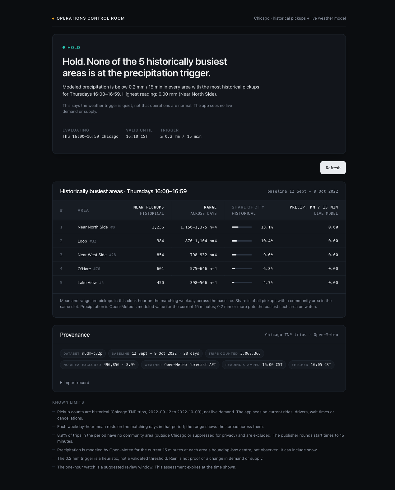
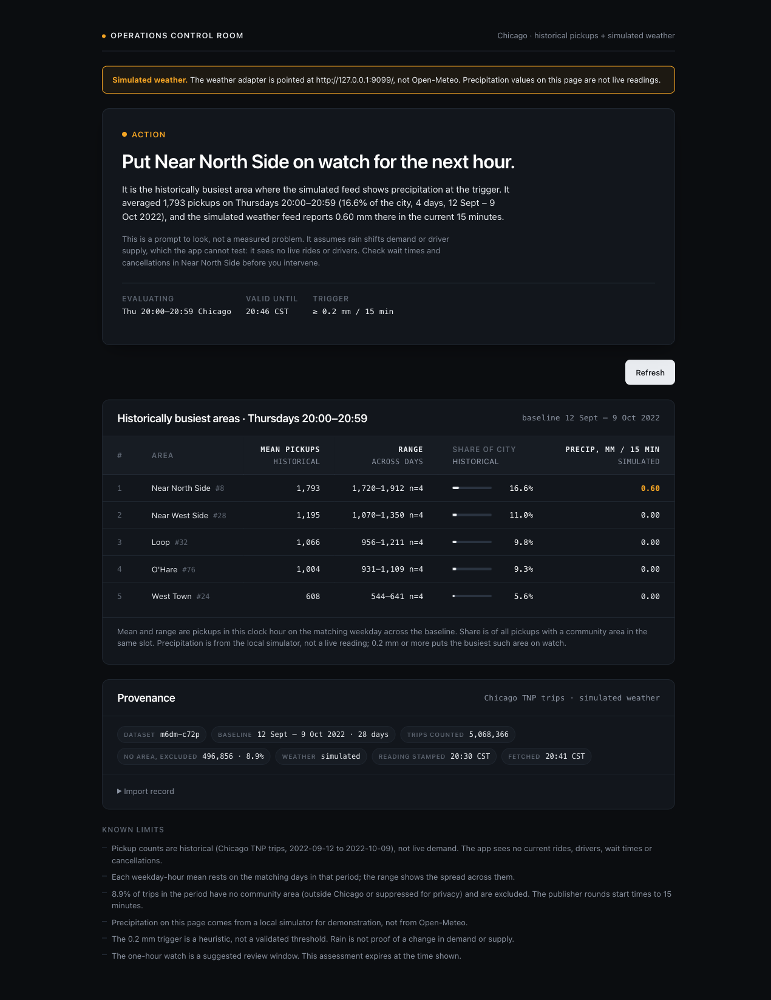
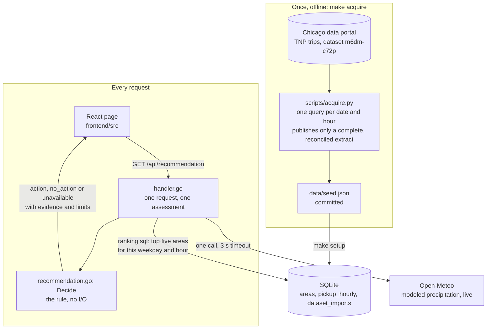

# Operations Control Room

One recommendation for a Chicago rideshare operator: **which area to put on watch right now, or that no watch is needed.**

It combines a historical pickup baseline (Chicago Transportation Network Providers trips) with one live external API (the Open-Meteo weather model).

The rule is deliberately small. Take the five community areas with the most historical pickups for the current weekday and hour. If the weather model shows precipitation of 0.2 mm or more per 15 minutes in one of them, recommend a one-hour watch on the busiest such area. Otherwise say "hold" and show why.

The app does not see live demand, drivers, wait times or cancellations, and says so on the page.



## Run it

Needs Go 1.25+, Node 22+ and make. Python 3 is used only by `make test` (acquisition tests), `make demo` and `make acquire`.

```sh
make setup   # Go modules, npm ci, frontend build, SQLite rebuilt from the committed seed
make run     # http://127.0.0.1:8080
```

Or with Docker, nothing else installed:

```sh
docker build -t operations-control-room .
docker run --rm -p 8080:8080 operations-control-room
```

`make test` runs the Python acquisition tests, `go test`, `go vet`, the frontend lint, the TypeScript type-check and the frontend tests. That last step needs Node 22.18 or newer.

**Configuration.** None is needed: no API keys, environment variables or config files. The server takes flags, all with defaults: `-addr` (`127.0.0.1:8080`), `-db` (`data/control.db`), `-seed` (`data/seed.json`), `-static` (`frontend/dist`), `-weather-url` (Open-Meteo; anything else is labelled simulated) and `-init-only`. `make run ARGS="-addr 127.0.0.1:9000"` passes flags through. The two deployment files, `vercel.json` and `Dockerfile`, are complete as committed.

## Seeing the action state on a dry day

Most of the time it is not raining, so the live app says "hold". To see the other state:

```sh
make demo
```

This runs the same server, SQL and decision code, with the weather adapter pointed at a local simulator (`scripts/sim_weather.py`) that reports 0.6 mm at the busiest area. The API marks the response `weather.simulated: true` and the page carries a banner. The server contains no fake-data generator; it only accepts a different weather URL and labels the result.



More screenshots: [action on live weather](docs/evidence/screenshots/action-live-weather.png) (Open-Meteo reported 0.20 mm at the three busiest areas on the evening of 12 November 2026), [phone width](docs/evidence/screenshots/hold-phone-390.png), [weather source unreachable](docs/evidence/screenshots/unavailable-weather-unreachable.png), [refresh failed, assessment kept](docs/evidence/screenshots/refresh-failed-assessment-kept.png), [first load timed out](docs/evidence/screenshots/error-timeout.png).

## How the recommendation is made

1. Find the current weekday and clock hour in Chicago.
2. SQL ranks community areas by mean historical pickups for that weekday-hour and returns the top five.
3. One Open-Meteo request returns modeled precipitation for the current 15 minutes at those five points.
4. Walk the five in rank order:
   - the first area at or above the trigger becomes the recommendation, provided every busier area has a valid, dry reading;
   - if a busier area's reading is missing or invalid, the answer is "unavailable" rather than a guess. A missing reading is never treated as dry;
   - if all five are valid and dry, the answer is "hold".
5. The answer expires after 5 minutes, at the end of the clock hour, or when a reading it relied on turns 30 minutes old, whichever comes first. The page stops presenting it as current at that moment.

Areas are ranked by volume on purpose. An earlier version ranked by a ratio (this hour against the area's own average) and put an area with 9 trips first; ratios over small counts are noise. Volume answers the operator's question: where would disruption affect the most pickups.

## States

`GET /api/recommendation` answers with one of three statuses. `unavailable` also carries a `reason_code`.

| `status` | `reason_code` | The operator sees | How to see it |
|---|---|---|---|
| `action` | | "Put *area* on watch for the next hour", the reading and the caveat | `make demo`, or `make run` when it rains |
| `no_action` | | "Hold", with the highest reading among the five | `make run` on a dry day |
| `unavailable` | `weather_unavailable` | "No recommendation right now": the weather source gave no usable reading | `make run ARGS="-weather-url http://127.0.0.1:9/"` |
| `unavailable` | `weather_invalid` | The same, naming the area whose reading failed validation | Tests |
| `unavailable` | `no_history` | The same: no pickups in the baseline for this weekday and hour | Tests; cannot occur with the committed seed |

Each candidate carries its own evidence state: `valid` (a reading that passed every check), `invalid` (a reading that failed one, with the reason) or `missing` (no reading, because the request failed). Only `valid` is ever read as wet or dry.

HTTP 503 with `{"error": "assessment_unavailable"}` is different: the server itself could not answer.

On the page:

- **Loading** and **Error** mean there is nothing to show yet. On a first-load failure the page shows nothing rather than something stale.
- Once an assessment is on screen it stays until a newer one replaces it. **Refresh** re-checks in place. If the refresh fails, the assessment stays, with a notice saying what failed and when the assessment was made.
- **The page re-checks by itself**: 10 seconds before an assessment expires, and a minute after an "unavailable" answer or a failed request. It never asks more than once in 5 seconds, and not at all while the tab is hidden. In normal running that is one request every five minutes.
- **Expired**: when validity ends the page says so and greys out the evidence. With the re-check working this is rarely seen; it appears when a re-check fails or the tab was hidden. A failed refresh does not postpone it.
- The length of validity comes from the server (`valid_until` minus `assessed_at`). The page counts it from the moment it asked, so a wrong browser clock cannot keep an old answer on screen.

A real response, shortened to one candidate and one limitation:

```json
{
  "status": "action",
  "reason": "modeled precipitation at or above the trigger",
  "slot_start": "2026-11-13T02:00:00Z",
  "assessed_at": "2026-11-13T02:47:03.25156Z",
  "valid_until": "2026-11-13T02:52:03.25156Z",
  "trigger_mm": 0.2,
  "area": { "area_id": 8, "name": "Near North Side" },
  "candidates": [
    {
      "rank": 1, "area_id": 8, "name": "Near North Side", "lat": 41.898954, "lon": -87.628877,
      "sample_days": 4, "mean_trips": 1793, "min_trips": 1720, "max_trips": 1912,
      "city_share": 0.1656159796790209,
      "weather": {
        "state": "valid", "precipitation_mm": 0.2, "interval_seconds": 900, "units": "mm",
        "valid_at": "2026-11-13T02:45:00Z"
      }
    }
  ],
  "history": {
    "dataset_id": "m6dm-c72p", "period_start": "2022-09-12", "period_end": "2022-10-09",
    "retrieved_at": "2026-11-12T21:50:09+00:00",
    "rows_loaded": 51744, "trips_included": 5068366, "trips_excluded_invalid_area": 496856
  },
  "weather": {
    "source": "https://api.open-meteo.com/v1/forecast", "simulated": false,
    "fetched_at": "2026-11-13T02:47:03.454102Z"
  },
  "limitations": ["Pickup counts are historical (Chicago TNP trips, 2022-09-12 to 2022-10-09), not live demand. …"]
}
```

`slot_start` is the start of the Chicago clock hour being evaluated; `assessed_at` is when the answer was made.

## Architecture



The same layout as files:

```
frontend/  React + TypeScript + Vite, plain CSS
   │  GET /api/recommendation
   ▼
backend/   Go, net/http + database/sql + modernc.org/sqlite (pure Go)
   ├── cmd/server/main.go                 local entry: flags, startup, static files
   ├── serverless/handler.go              hosted entry: same service, built once per instance
   └── internal/control/
       ├── schema.sql, ranking.sql        embedded SQL
       ├── store.go                       seed validation, DB init, ranking query
       ├── weather.go                     Open-Meteo adapter and reading validation
       ├── recommendation.go              Decide(): the rule above, no I/O
       └── handler.go                     one request, one assessment

api/recommendation.go   the file Vercel turns into a function; calls backend/serverless
data/seed.json          committed historical extract, loaded into SQLite
scripts/acquire.py      rebuilds the seed from the Chicago data portal
go.mod                  one Go module for the repository
```

Chicago's portal is never called while serving a request. The only live call is Open-Meteo: 3-second timeout, 1 MiB body cap, one request per assessment, no retries or cache.

The states above are defined once on each side: constants in `backend/internal/control/types.go`, and one union type in `frontend/src/api.ts` whose parser rejects any response that contradicts itself (for example "hold" with a missing reading). Adding a status fails type-checking until the page has a label and copy for it.

## Database and SQL

Three SQLite tables (`backend/internal/control/schema.sql`), all with `CHECK` constraints:

| Table | Holds |
|---|---|
| `areas` | the 77 community areas, with a point for the weather lookup |
| `pickup_hourly` | one row per area, calendar day and clock hour: `(area_id, service_date, hour, trips)` |
| `dataset_imports` | where the data came from: dataset, period, query, totals |

The table stores observations, not pre-computed averages, so the aggregation happens in SQL at request time (`backend/internal/control/ranking.sql`):

```sql
WITH slot AS (
  SELECT
    area_id,
    COUNT(*)   AS sample_days,
    AVG(trips) AS mean_trips,
    MIN(trips) AS min_trips,
    MAX(trips) AS max_trips
  FROM pickup_hourly
  WHERE hour = :hour
    AND CAST(strftime('%w', service_date) AS INTEGER) = :dow
  GROUP BY area_id
)
SELECT
  s.area_id, a.name, a.lat, a.lon,
  s.sample_days, s.mean_trips, s.min_trips, s.max_trips,
  s.mean_trips / SUM(s.mean_trips) OVER () AS city_share
FROM slot s
JOIN areas a USING (area_id)
WHERE s.mean_trips > 0
ORDER BY s.mean_trips DESC, s.area_id ASC
LIMIT 5;
```

- **Aggregation:** the matching days for each area are reduced to a mean, a range and a sample size. Days with zero pickups are stored, so they count in the mean.
- **Comparison:** the window `SUM(...) OVER ()` gives each area's share of all pickups that have a community area in that slot. It is computed before the limit, so areas outside the top five stay in the denominator.
- **Ranking:** mean pickups descending, area id as a deterministic tie-break, top five.

The weekday comes from the date inside SQL, so the seed cannot disagree with itself about which day a date was. The plan uses the `hour` index: `SEARCH pickup_hourly USING INDEX pickup_hourly_hour (hour=?)`.

Example, Thursdays 15:00–15:59:

| Area | Mean pickups | Range (4 days) | Share of city |
|---|---|---|---|
| Near North Side | 1,068 | 1,004–1,170 | 12.5% |
| Loop | 880 | 843–977 | 10.3% |
| Near West Side | 721 | 650–791 | 8.4% |
| O'Hare | 701 | 632–810 | 8.2% |
| Lake View | 364 | 333–423 | 4.3% |

## Data

**Historical:** City of Chicago, *Transportation Network Providers – Trips (2018–2022)*, dataset `m6dm-c72p`, the dataset linked from the assignment.

- Period: Monday 12 September to Sunday 9 October 2022. Four consecutive weeks with no US federal holiday, so every weekday-hour has four observations. The Chicago Marathon falls on the last Sunday.
- 672 hourly windows × 77 areas = 51,744 rows; 5,068,366 trips.
- 496,856 trips (8.9%) carry no community area (pickups outside Chicago, or suppressed for privacy) and are excluded. The count is measured, not assumed.

**How it was acquired** (`make acquire`, not needed to run the app):

- The portal times out on wide grouped queries, so the script sends one small aggregation per date and hour and caches each response. A rerun resumes where the last one stopped.
- Windows are half-open (`>= start AND < end`). The publisher rounds trip start times to 15 minutes, so an inclusive `between` counts every trip stamped HH:00 in two hours. An earlier extract did exactly that and was about 25% too high.
- Nothing is published unless every window is present and three pairs of adjacent hours match an independent live two-hour count. An empty answer counts as a failed window, never as a zero hour. The run that produced the committed seed stopped two windows short on its first pass, published nothing, and completed on the rerun (figures in [docs/decisions.md](docs/decisions.md)).

**Live:** Open-Meteo forecast API, `current=precipitation`, no API key. A reading is used only if it is in millimetres, covers a 15-minute interval, is not negative, and is at most 30 minutes old.

## Tests

`make test`. The three worth reading first:

- `store_test.go` · `TestRankAggregatesMatchingDaysInSQL`: real SQLite, real query; checks mean, range, sample size and city share, including a zero day.
- `service_test.go` · `TestService_ActionNamesTheBusiestWetArea`: real handler, real SQL, weather stubbed at the HTTP boundary; the busiest area is dry, the second is wet, the second is recommended.
- `service_test.go` · `TestService_UpstreamFailureIsReportedOnce`: Open-Meteo answers 500; the result is "unavailable" (`weather_unavailable`) with no expiry, every reading `missing` and none invented.

Also covered: a missing reading can never produce "hold" (`TestDecide_MissingReadingIsNeverDry`), each `unavailable` reason through the real handler, a small-count spike cannot outrank a busier area (the ratio-ranking regression), the top-five cut and its share denominator, tie-breaks, seed validation, refusing a database that no longer matches the seed, the decision rule's edge cases, weather response validation, the repeated clock hour when daylight saving ends, and the acquisition script (window boundaries, parsing, publish gate).

Frontend: `frontend/test/api.test.mjs` checks the response parser, the place where the page decides whether a response can be trusted. It runs on Node's built-in test runner, so there is no test dependency. Each response that contradicts itself (for example "hold" with a missing reading, or no `simulated` flag) must be rejected. The timing of refresh and expiry was exercised in a browser with a controlled clock; the results are in [docs/ai-use-log.md](docs/ai-use-log.md).

## Changing the code

```sh
make run                      # API and built UI on :8080
cd frontend && npm run dev    # UI on :5173 with reload; /api is proxied to :8080
make test
```

`make run` serves the built frontend from `frontend/dist`. After a UI change, use the dev server or run `npm run build`. `make setup` can be rerun at any time; it rebuilds the local database from the seed, so restart `make run` afterwards.

## Deploying

Two ways, both from the repository as committed.

- **Vercel.** Import the repository; `vercel.json` carries the settings. The frontend is built as a static site and `api/recommendation.go` becomes a Go function that serves the same `control.Service`. The function has no disk of its own, so the seed is compiled in and SQLite is rebuilt from it in the temp directory when an instance starts.
- **Any container host** (Render, Fly, Cloud Run). The `Dockerfile` runs the same server as `make run`, listens on `$PORT`, and has the database built into the image. Checked locally: ready in under a second with 0.1 CPU and 512 MB.

## Assumptions, trade-offs and limits

- **The link between rain and operations is assumed, not measured.** Rain is treated as a reason to look, never as proof of a demand or supply change. The 0.2 mm trigger is a heuristic.
- **The baseline is four weeks from 2022.** Four observations per weekday-hour; patterns may have shifted since. The range column shows the spread.
- **The busiest areas sit close together**, so modeled precipitation often agrees across them. In practice the question is mostly "is it wet where volume is highest".
- **Hour edges are approximate.** The publisher rounds start times to 15 minutes.
- **Weather is modeled, not observed**, read at each area's bounding-box centre, and can include snow.
- **Only the top five areas are evaluated.** Rain in a sixth, quieter area produces "hold".
- **One weather request per assessment, no retry on the server.** A single slow answer from Open-Meteo gives "unavailable" until the page re-checks a minute later.
- **Scope left out on purpose:** auth, maps, history of past recommendations, caching, server-side retries. None would improve the one decision.

## AI use

The brief asks six questions about AI use. Each has its own heading below. The full record, written as the work happened, is [docs/ai-use-log.md](docs/ai-use-log.md); decisions are in [docs/decisions.md](docs/decisions.md).

Most of the code in this repository was written by AI tools under my direction. I set the scope and the product decision, rejected the outputs listed below, and required evidence (a failing test, a comparison with the live source, or a browser run) before accepting a result.

### Which tools, and what each was used for

| Tool | Used for |
|---|---|
| Codex | The first requirements breakdown and plan, the first acquisition script and its tests, and the first probes of the Chicago data portal |
| Claude Code | The Go service, the SQL, the React interface, the corrections, and drafts of this documentation |
| Claude Code reviewer agents (read-only: SQL and data, product claims, Go, UI) | An independent read of each finished change. They could read files and run tests, not edit |
| Design skills inside Claude Code (impeccable, taste-skill) | The visual redesign of the interface |
| Playwright, driven by Claude Code | Checking every page state in a real browser, including with a controlled clock |

### Suggestions and outputs I accepted

- **Most important: acquisition as one small query per date and hour, with a resumable cache and an all-or-nothing publish gate.** The portal times out on wide queries, and this is what produced real data. Checked by the run itself: the first pass finished 670 of 672 windows and published nothing; the rerun fetched the last two, and three pairs of adjacent hours matched an independent live count. A separate spot check: seed total for 2022-09-29 17:00 is 10,744, the live count is 10,744.
- **Storing observations and aggregating in SQL.** One row per area, day and hour, with the mean, range, sample size and city share computed by `GROUP BY` and a window function at request time. Checked with a fixture test that includes a zero day, and by comparing the API's top five with a direct `sqlite3` run of the same query.
- **The decision rule as one pure function** (`Decide`), which the handler only feeds. Every branch has a test, and the service tests drive it through real SQL with the weather stubbed at the HTTP boundary.
- **A seam for simulated weather** (`-weather-url`) instead of a fake-data mode inside the server, so that everything except the weather input stays real. Checked in a browser: the API flag, the banner, and no remaining claim that the reading is from Open-Meteo.
- **Keeping an assessment on screen through a refresh, and counting its validity from the request rather than the browser clock.** Checked with a controlled clock: with the browser 10 minutes slow, an assessment still expired 5 minutes after it was fetched.

### Suggestions I rejected or substantially changed

- **Most important: ranking by a "surge ratio"** (this hour against the area's own average). An AI review recommended it and it was built. On the running app it put Hegewisch first with 9 trips, above Near North Side with 1,562. A ratio over small counts is noise. Replaced by mean pickups, with a regression test.
- **A synthetic baseline.** When the portal kept timing out, the AI shipped a generated dataset, clearly labelled. I rejected it: the brief asks for a public mobility dataset. Further probing found that the portal answers narrow one-hour queries, which led to the acquisition design above.
- **A daylight-saving "fix".** An AI review called truncating the instant a bug and replaced it with rebuilding the hour from local date parts. A test for the repeated 01:00 hour failed against that code (it returned 06:00Z for an instant at 07:30Z) and passes with truncation. Reverted.
- **Recommending that drivers be repositioned.** The data has no supply signal, so the recommendation became "put this area on watch", with a caveat that says what the app cannot see.
- **Smaller ones**: a full-year baseline (the portal could not serve it); five reason codes cut to three; a frontend test library (not needed, Node runs the tests directly); a lookup table for live and simulated wording (it would only move strings).

### How AI-generated code was reviewed and validated

- **Tests written to fail first** for each defect: the missing weather reading, the repeated daylight-saving hour, the ratio ranking.
- **Comparison with the live sources.** Seed totals against fresh counts from the Chicago portal; API readings against a direct Open-Meteo request.
- **A browser pass over every state**: action, hold, unavailable, expired, loading, error, a stalled request, a failed refresh, malformed responses, phone width.
- **Independent reviewer agents** after each pass, told to break the change rather than approve it. Their findings and what was done about each are in the log.
- **My own check of the running app**: the screen and the raw API response after each pass. Builds that looked wrong were sent back, and a skeptical review of the running app against live data is what exposed the first five errors in the next list.
- **Mutation checks** where a claim depended on a test or the type-checker noticing: a rule was broken on purpose to see a test fail, then restored.

### Incorrect assumptions and risks the tools introduced

| What the AI did | What exposed it |
|---|---|
| Queried each hour with an inclusive `between`, counting every trip stamped HH:00 twice | Seed said 10,084 for one hour; the live half-open count was 8,025; trips stamped exactly on the next hour were 2,059 |
| Ranked by a ratio that promoted a 9-trip area | The running app's first row |
| Wrote "0 trips excluded" in the manifest without measuring | One live hour had 801 trips with no area; the measured share is 8.9% |
| Labelled 2022 counts "This hour" under a "live" header | Reading the screen against the product rule |
| Rewrote the acquisition script without rerunning its tests | Two of three tests failed; one `make` target passed a flag that no longer existed |
| Let a missing weather reading count as dry in the decision | Reading the code; a new test returned "hold" for a candidate with no reading |
| Let the page crash or mislabel on two malformed responses | Reading the code, then feeding those responses in a browser |
| Verified a change against a stale cached build | The loaded script name did not match the build; the server now tells the browser to revalidate the page |
| Assumed frontend tests needed a new dependency | Running the parser under plain Node |
| Cached a failed start in the hosted entry point for the life of the instance | A reviewer agent; fixed with a test that fails once, then succeeds |

The general risk: the tools report "done" confidently. Several of the errors above were in code that had been described as finished and verified. The rule I ended up with is that nothing counts as done until it has been checked against the running app or the live source.

### The parts I found most technically challenging

- **Getting real data** out of a portal that answers only narrow aggregations and fails intermittently. Acquisition had to be resumable, bounded, and unable to publish a partial extract.
- **Choosing an honest ranking.** The clever estimator (ratio) was wrong and the plain one (volume) was right, and that only showed on real data.
- **Time.** Half-open hourly windows over timestamps the publisher rounds to 15 minutes; the repeated hour when daylight saving ends; expiring an answer on time without trusting the browser's clock.
- **Keeping every claim on the page true**: historical is never shown as live, simulated is never shown as live, and missing is never shown as zero.
